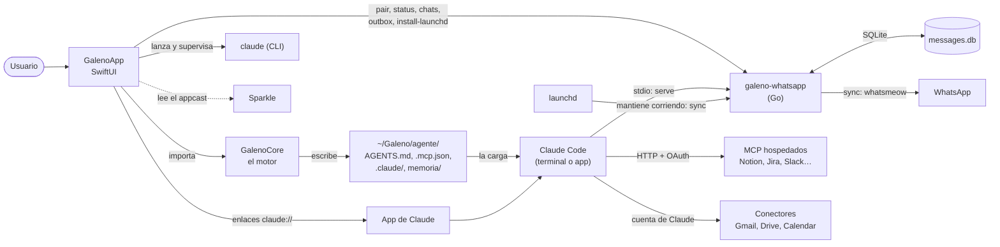
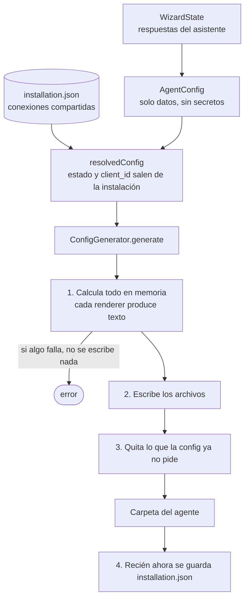
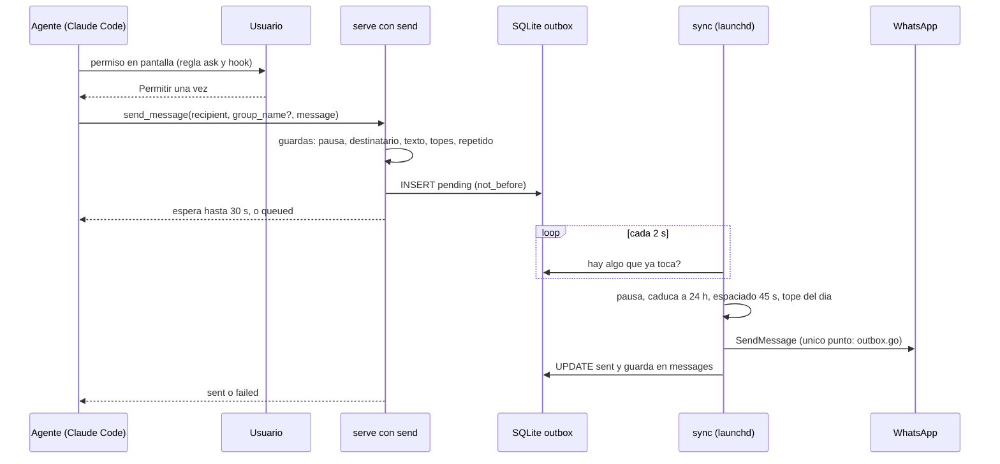
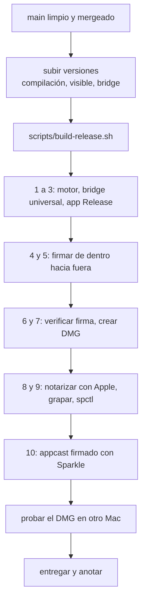

# Galeno

Documentación técnica y de procesos de Galeno, escrita para quien la construye y la entrega (hoy, una persona).
Responde dos preguntas: **cómo está hecha** y **cómo se hace cada cosa** (sobre todo, sacar una versión).

No lleva estado ni pendientes: eso vive en [`HANDOFF.md`](HANDOFF.md). Las reglas de trabajo para agentes están en
[`AGENTS.md`](AGENTS.md); el alcance y el porqué de cada decisión, en
[`docs/03-especificacion-v0.0.1.md`](docs/03-especificacion-v0.0.1.md) (si algo de aquí la contradice, gana la spec).

## Índice

1. [Qué es Galeno](#1-qué-es-galeno)
2. [Mapa del repositorio](#2-mapa-del-repositorio)
3. [Arquitectura](#3-arquitectura)
4. [Cómo funciona por dentro](#4-cómo-funciona-por-dentro)
   - [4.1 Crear un agente](#41-crear-un-agente)
   - [4.2 Conectar una herramienta](#42-conectar-una-herramienta)
   - [4.3 Cómo sale un mensaje de WhatsApp](#43-cómo-sale-un-mensaje-de-whatsapp)
   - [4.4 Los permisos del agente generado](#44-los-permisos-del-agente-generado)
   - [4.5 Abrir un agente en Claude](#45-abrir-un-agente-en-claude)
   - [4.6 Skills](#46-skills)
   - [4.7 Qué guarda cada cosa y dónde](#47-qué-guarda-cada-cosa-y-dónde)
5. [El bridge de WhatsApp](#5-el-bridge-de-whatsapp)
6. [Skills y catálogo](#6-skills-y-catálogo)
7. [Textos, idiomas y diseño](#7-textos-idiomas-y-diseño)
8. [Líneas rojas y decisiones cerradas](#8-líneas-rojas-y-decisiones-cerradas)
9. [Desarrollo en local](#9-desarrollo-en-local)
10. [Procesos](#10-procesos)
    - [10.1 Sacar una versión nueva (hoy, a mano)](#101-sacar-una-versión-nueva-hoy-a-mano)
    - [10.2 Cuando haya appcast (getgaleno.com)](#102-cuando-haya-appcast-getgalenocom)
    - [10.3 Actualizar el bridge de WhatsApp](#103-actualizar-el-bridge-de-whatsapp)
    - [10.4 Tocar skills y el catálogo](#104-tocar-skills-y-el-catálogo)
    - [10.5 Añadir una herramienta (servicio MCP) nueva](#105-añadir-una-herramienta-servicio-mcp-nueva)
    - [10.6 Instalar a un cliente](#106-instalar-a-un-cliente)
    - [10.7 Resets y pruebas manuales](#107-resets-y-pruebas-manuales)
    - [10.8 Cuando algo falla](#108-cuando-algo-falla)
    - [10.9 Cambiar una decisión y el flujo de Git](#109-cambiar-una-decisión-y-el-flujo-de-git)
11. [Claves y secretos](#11-claves-y-secretos)
12. [Referencias](#12-referencias)

---

## 1. Qué es Galeno

App nativa de **macOS 14 o superior** que, con un asistente, **crea y configura un agente en Claude Code** para gente de
**producto, marketing y comercial** (los tres roles son una decisión cerrada). Le conecta sus herramientas (Notion,
Slack, Jira, Gmail, Google Drive, WhatsApp…) y escribe la configuración con los permisos ya puestos: lo que el agente
lee, lo que puede escribir y lo que siempre pide aprobación.

Un **agente es una carpeta** (`~/Galeno/<nombre>/`). Galeno no es un chat: no corre el modelo, no guarda conversaciones
y no recibe nada del usuario en servidores propios. Genera la carpeta, lanza procesos locales (`claude`, el bridge de
WhatsApp) y abre el agente en la app de Claude o en Terminal. Quien conversa es Claude Code.

Se vende como pago único. El dominio del sitio y del appcast es **getgaleno.com**. La versión visible de la app es
`MARKETING_VERSION` del proyecto de Xcode; la del bridge, `whatsapp-bridge/version.go`; son independientes.

**Qué hay en el producto, en una frase por pieza:**

| Pieza | Para qué |
|---|---|
| **GalenoApp** | La ventana: asistente de creación, home con los agentes, detalle de cada agente, salud |
| **GalenoCore** | El motor: de las respuestas del asistente a los archivos de la carpeta del agente |
| **whatsapp-bridge** | Un binario en Go: lee WhatsApp y, con aprobación, envía un mensaje a la vez |
| **skills/** | Las instrucciones que se copian al agente (nuestras, curadas de terceros y las del usuario) |
| **Sparkle** | Las actualizaciones de la app |

**Vocabulario que se usa en todo el documento**

| Término | Qué es |
|---|---|
| **MCP** | *Model Context Protocol*: cómo Claude Code habla con herramientas externas. Cada herramienta es un «servidor MCP» (por HTTP o por un proceso local). |
| **Hook** | Un script que Claude Code corre **antes** de usar una herramienta (`PreToolUse`) y que puede exigir aprobación. |
| **Conector de la cuenta de Claude** | Un MCP que el usuario conecta en claude.ai (Gmail, Drive, Calendar). Galeno no lo registra: solo guía y escribe sus permisos. |
| **Bridge** | El binario Go `galeno-whatsapp`. |
| **`sync` / `serve`** | Los dos modos del bridge: `sync` mantiene la conexión viva a WhatsApp; `serve` es el servidor MCP que lanza Claude Code. |
| **Appcast** | Un archivo XML público con la lista de versiones, de dónde se baja cada una y su firma. Sparkle lo lee. |
| **Notarización** | Apple revisa la app y la «sella»; sin ella macOS no la abre sin avisos. |
| **LaunchAgent** | Un servicio de usuario que `launchd` mantiene corriendo; así corre `sync`. |
| **JID** | El identificador de un chat de WhatsApp: `número@s.whatsapp.net` (persona), `…@g.us` (grupo), `…@lid` (identificador oculto de una persona). |

---

## 2. Mapa del repositorio

```
galeno/
├── GalenoApp/            App SwiftUI (proyecto de Xcode)
│   ├── Galeno/           El código de la app
│   │   ├── Wizard/       El asistente: pasos, conexión de herramientas, estado y borrador
│   │   ├── Home/         El home: la mesa con los personajes, las tarjetas, «Abrir»
│   │   ├── Agent/        El detalle de un agente (cinco secciones)
│   │   ├── Health/       Salud: conexiones, WhatsApp, skills, carpetas
│   │   ├── System/       Todo lo que toca el sistema: procesos, bridge, Claude, instalación
│   │   └── …             Tema, tipografías, controles propios, sonidos, ajustes, Sparkle
│   ├── GalenoTests/      Pruebas de la app (se corren en CI)
│   ├── GalenoUITests/    Pruebas de interfaz (piden entorno gráfico; no corren en CI)
│   ├── arte-mesa/        Cómo se hicieron las láminas del home (no entra en la app)
│   ├── Galeno-Info.plist Claves de Sparkle (se fusiona con el Info.plist generado)
│   ├── Galeno.entitlements   Vacío a propósito
│   └── THIRD_PARTY.md    Licencias de logos, fuentes, grabados y retratos
├── GalenoCore/           Swift Package: el motor (sin dependencias de UI)
│   ├── Sources/GalenoCore/{Model,Generator,Installation,Skills,SlackSetup}
│   ├── Sources/galeno-gen/   Herramienta de desarrollo (no se distribuye)
│   └── Tests/            Pruebas, fixtures y snapshots
├── whatsapp-bridge/      Binario Go: puente de WhatsApp + servidor MCP
├── skills/               Contenido: skills nuestras (galeno/), curadas (curated/) y el catálogo (catalog.json)
├── site/                 Sitio web de venta (por construir) y, luego, el appcast
├── scripts/              Entrega, instalación y pruebas (ver 10)
├── docs/                 Spec, design system, QA, entrega, plan de Simon
├── .github/workflows/    CI
├── AGENTS.md             Reglas para agentes de código (incluye las líneas rojas)
└── HANDOFF.md            Diario de decisiones y estado
```

**Límites entre carpetas** (se hacen cumplir en el código):

- `GalenoApp` **no contiene lógica de generación**: la pide a `GalenoCore`.
- `GalenoCore` **no importa SwiftUI** ni depende de la UI; se prueba solo.
- `whatsapp-bridge` es **autocontenido**: habla con Claude Code por stdio y con la app como proceso hijo.
- `skills/` es **contenido**, no código; el motor lo copia a cada agente.

**Dependencias.** Solo estas, y nada más (ni Python, ni Node, ni Rust, ni contenedor web):

| Dónde | Qué | Cómo se fija |
|---|---|---|
| App | **Sparkle** 2.10.0 | Paquete de Swift, versión exacta (se sube a propósito, mirando qué cambia) |
| Bridge | `whatsmeow` (WhatsApp Web), `modelcontextprotocol/go-sdk`, `mattn/go-sqlite3` (cgo), `mdp/qrterminal`, `rsc.io/qr` | `go.mod` |
| Entrega | `create-dmg` (Homebrew) | Solo en el Mac que entrega |

---

## 3. Arquitectura

### 3.1 Las piezas y cómo se hablan



Cómo leerlo:

- **La app genera y supervisa, no conversa.** Después de generar la carpeta, el agente corre en Claude Code.
- **El bridge tiene dos caras que nunca se conectan a la vez a WhatsApp.** `sync` (lo mantiene `launchd`) es la **única**
  conexión viva: recibe mensajes, los guarda y despacha los que hay que enviar. `serve` (lo lanza Claude Code, uno por
  sesión) **no se conecta a WhatsApp**: lee SQLite y escribe en la bandeja de salida. Dos conexiones del mismo dispositivo
  es justo lo que WhatsApp puede marcar como anómalo.
- **Los permisos viven en la carpeta del agente**, no en la app: `.claude/settings.json` y los hooks. La app solo los escribe.

### 3.2 La regla de quién habla con qué

| Quién | Habla con | Cómo |
|---|---|---|
| Wizard / home / salud | Motor | Llamadas de Swift (`ConfigGenerator`, `GalenoInstallation`) |
| App | `claude` | Procesos hijo (`claude mcp add`, `mcp login`, `mcp list`, `auth login`, sondeo de sesión) |
| App | Bridge | Procesos hijo con salida en JSON (`status --json`, `chats --json`, `outbox --json`) y archivos en su carpeta de estado (pausa, topes) |
| App | App de Claude | Enlaces `claude://…` y salir/volver a abrir la app |
| Claude Code | Bridge | MCP por stdio (`galeno-whatsapp serve`) |
| Claude Code | Servicios | MCP por HTTP con OAuth, o los conectores de la cuenta |
| `sync` | WhatsApp | `whatsmeow` |

Toda la app trabaja contra **protocolos** (`WhatsAppLinking`, `MCPConnecting`, `SessionProbing`, `CommandRunning`,
`AgentOpening`…) con una implementación real y otra falsa. Por eso las pruebas no tocan el disco, ni tu cuenta, ni
WhatsApp.

---

## 4. Cómo funciona por dentro

### 4.1 Crear un agente

**Los tres modos del asistente** (`WizardState.Mode`):

| Modo | Cuándo | Qué hace |
|---|---|---|
| `full` | La primera vez | Todos los pasos, con onboarding antes. Guarda un borrador (`draft.json`) por si se cierra a medias. |
| `short` | «Nuevo agente» desde el home | Parte de lo ya conectado en la instalación: rol, nombre, qué leer, skills, reglas. |
| `edit` | «Gestionar» un agente | Regenera la carpeta **del mismo agente**; avisa de que lo editado a mano se pierde. |

**Los pasos** (`WizardStep`): rol → detección de Claude Code → nombre → contexto (opcional) → herramientas → conexión →
skills → reglas → revisión → creación → listo. El **rol** (producto, marketing, comercial) decide qué skills vienen
marcadas, en qué orden se ofrecen las herramientas y cómo se presenta el agente. El paso de detección deja listo
Claude Code: lo instala, lo actualiza (versión mínima en `ClaudeCodeDetector.minimumVersion`) y abre `claude auth login`.

**De las respuestas a la carpeta:**



El orden importa: **primero se genera y después se guarda la instalación** (`AgentInstaller.install`). Si algo falla,
`installation.json` no se toca y no queda un agente apuntando a una carpeta que no existe.

**Qué escribe el motor** (`ConfigGenerator`), y quién es dueño de cada cosa:

| Archivo | Lo escribe | Contenido |
|---|---|---|
| `AGENTS.md` | Motor | Identidad, qué lee, qué escribe, reglas, tareas programadas, skills. En el idioma del usuario. |
| `CLAUDE.md` | Motor | Dos líneas: importa `AGENTS.md` y `memoria/proyecto.md`, para que carguen siempre. Si el usuario ya tenía uno propio, no se pisa. |
| `.mcp.json` | Motor | Los servidores MCP **que se registran** (WhatsApp, y los hospedados). Nunca un secreto: solo referencias. |
| `.claude/settings.json` | Motor | Permisos (`allow` / `ask` / `deny`), hooks y `effortLevel` (ver 4.4). |
| `.claude/hooks/*.sh` | Motor | Los hooks de aprobación; solo si hay algo que pueda salir hacia afuera. |
| `.claude/agents/*.md` | Motor | Tres subagentes de solo lectura: `scribe`, `tracker`, `reporter`. |
| `.claude/skills/<id>/` | Motor | Copia de las skills marcadas. |
| `memoria/proyecto.md` | Motor, **una sola vez** | La memoria del agente. Nunca se vuelve a tocar. |
| `memoria/contexto/*` | Motor, **si no existe** | El material que el usuario trajo al crear el agente. Dato de terceros: nunca va a `AGENTS.md`. |
| `memoria/**` (informes, radiografías, pendientes, borradores de skills) | **El agente** | Lo único donde el agente escribe. |
| `skills-propias/<id>/` | **La app** (al importar) | Las skills del usuario. El motor nunca la escribe ni la borra; solo instala desde ahí. |

Dos propiedades que las pruebas vigilan:

- **Regenerar deja la carpeta idéntica a una nueva con la misma config** (`GeneratorFixtures` + los *snapshots*).
- **El agente solo escribe en `memoria/`**, y el motor niega por nombre (`SettingsRenderer.protectedPaths`) todo lo que él
  mismo genera. Si el generador empieza a escribir un archivo nuevo fuera de `memoria/`, hay que añadirlo ahí; una prueba falla si se olvida.

### 4.2 Conectar una herramienta

Las herramientas (`Tool`) llegan al agente por **tres caminos distintos**:

| Camino | Herramientas | Cómo se conecta |
|---|---|---|
| **MCP hospedado** (HTTP + OAuth) | Notion, Jira, Fathom, Fireflies, Granola, Claude Design | `claude mcp add --transport http -s user galeno-<nombre> <url>` y después `claude mcp login`, que abre el **navegador predeterminado** del usuario. La vuelta de OAuth va a `localhost` y Galeno vuelve al frente (`AppFocus`). |
| **Slack** (MCP hospedado con app propia) | Slack | Slack exige una app registrada por el cliente. Galeno la crea por API (`SlackAppProvisioner`) y la autoriza en una ventana propia. Ver abajo. |
| **Conector de la cuenta de Claude** | Gmail, Google Drive/Docs/Sheets, Google Calendar (Meet se lee por Drive) | **Galeno no registra nada.** Guía al usuario a conectarlo en claude.ai y escribe sus reglas de permiso. |
| **Local** | WhatsApp | El bridge, por QR (ver 4.3 y 5). |

URLs de los hospedados (`MCPServerCatalog`): `https://mcp.notion.com/mcp`, `https://mcp.atlassian.com/v2/mcp` (Jira),
`https://api.fathom.ai/mcp`, `https://api.fireflies.ai/mcp`, `https://mcp.granola.ai/mcp`, `https://mcp.slack.com/mcp` y,
la excepción, `https://api.anthropic.com/v1/design/mcp` (Claude Design; su endpoint no está documentado).

**Los nombres.** Galeno registra sus conexiones **con prefijo propio** (`galeno-notion`, `galeno-slack`…). Los servidores de
Claude Code son de **todo el usuario**: cerrar la sesión o quitar uno lo desconecta en cualquier otro proyecto que use el
mismo nombre y dirección. Regla de propiedad: **Galeno solo cierra sesión o quita lo que lleva su prefijo**
(`ToolConnection.galenoOwnsServers`); un servidor con el nombre genérico no se mira, no se registra y no se desconecta.

**Slack, en detalle** (es el camino más complejo):

1. El usuario inicia sesión en `api.slack.com` en una ventana de Galeno (`SlackSignInWindow`, **una de las dos únicas
   vistas web de la app**; sesión efímera en memoria, el script de captura nunca lee campos de contraseña).
2. Galeno captura el token de configuración (a un `OAuthSecret`, nunca al portapapeles) y crea la app por API.
3. Slack devuelve el `client_secret` **en memoria**. Se entrega de inmediato a `claude mcp add --client-secret` **por el
   entorno del proceso** (`MCP_CLIENT_SECRET`), nunca en argumentos ni archivos, y se descarta.
4. El usuario autoriza la app en la segunda ventana (`SlackAuthorizeWindow`: solo `https` de `slack.com` y la vuelta
   exacta `http://localhost:51820/callback`).
5. El `client_id` (público) sí va en `.mcp.json`.

**Los conectores de la cuenta de Claude** tienen una dificultad: `claude mcp get` y `claude mcp list` los dan por
conectados aunque les falte la autorización de Google. El estado de verdad sale de **una sesión real**
(`ClaudeSessionProbe`: arranca una sesión corta y lee el primer evento `system/init`, campo `mcp_servers`). `pending`
nunca se trata como conectado; el paso del tiempo tampoco.

En la **app de Claude (escritorio)** los conectores se encienden por conversación y sus herramientas se llaman
`mcp__<uuid>__…`, así que ninguna regla de permiso por nombre coincide. Lo cubren **dos hooks por nombre de herramienta**
(4.4), y el `AGENTS.md` generado le dice al agente cómo encender **solo los suyos**.

**WhatsApp**: advertencia → `galeno-whatsapp pair` (QR como PNG en la carpeta de estado y en pantalla) →
`install-launchd` (deja `sync` corriendo) → espera a que baje el historial (no hay evento de «terminó»: se mira que el
número de chats deje de cambiar, una heurística). Al pasar la advertencia queda **`sendingAccepted`** (ver 4.3).

### 4.3 Cómo sale un mensaje de WhatsApp

Hay **un solo envío**: `send_message`, **texto**, a **una persona** o a **un grupo del usuario**. Siempre con aprobación.



**Dos compuertas, independientes:**

1. **La herramienta solo existe con `serve --with-send`**, y el motor lo escribe en `.mcp.json` **solo si** la conexión de
   WhatsApp lleva `sendingAccepted == true` (el usuario leyó la advertencia nueva). Se escribe **en la misma generación**
   que la regla `ask` y el hook: nunca una cosa sin las otras. Sin eso, el agente sigue siendo de solo lectura.
2. **Las guardas viven en el código del bridge, no en el prompt**, para que ni el agente ni una instrucción escondida
   las salten:

| Guarda | Valor | Dónde |
|---|---|---|
| Destinatario | Solo personas (`@s.whatsapp.net`) y grupos (`@g.us`); nunca difusión, estados ni canales | `serve` y otra vez `sync` |
| Grupo | Tiene que estar entre los chats del usuario y `group_name` tiene que ser su nombre guardado (el usuario lee el nombre al aprobar, no el identificador) | `serve`; `sync` comprueba que siga dentro |
| Tope diario total | 40 (techo fijo 80) | `serve` y `sync` |
| Tope de chats nuevos | 15 (techo 25) | `serve` |
| Tope a grupos | 10 (techo 20) | `serve` |
| Espaciado | 45 a 120 s al azar; `sync` nunca baja de 45 s | `serve` calcula, `sync` impone |
| Mismo texto | Rechaza si ya salió a más de 3 chats hoy | `serve` |
| Largo | 1.000 caracteres | `serve` |
| Pausa | Archivo `send-paused`: no entra nada nuevo y lo que esperaba se cancela | `serve` y `sync` |
| Caducidad | Un pendiente que lleva más de 24 h (Mac apagado, sin conexión) pasa a fallido y no sale | `sync` |

`send-limits.json` (lo escribe la app) solo puede **bajar** los topes: nunca sube por encima del techo del código. No hay
guarda de horario ni de festivos: el bridge no decide cuándo se escribe; el agente avisa si es de noche o domingo y decide
el usuario.

**Un mensaje, un permiso.** El permiso en pantalla **es** la aprobación: el `AGENTS.md` generado le dice al agente que no
pregunte antes en el chat, que pase `group_name` en la misma llamada que el identificador y que no mencione el horario
cuando es normal. (Una llamada de grupo sin `group_name` se rechaza, y el usuario terminaría aprobando dos veces.)

**Qué se verifica** (y falla el CI o `go test` si se rompe): `client.SendMessage(` solo en `outbox.go`
(`TestSendCallOnlyInOutbox`, más un paso de CI); una lista blanca exacta de símbolos con «send»
(`TestOnlyAllowedSendSymbols`); y que `serve` a secas ofrezca exactamente las 9 lecturas
(`TestSendMessageOnlyExistsWhenServeIsAskedForIt`).

**Quien ya tenía Galeno.** Una instalación guardada antes del envío no trae `sendingAccepted`, y se lee como «no aceptó»:
su agente **sigue solo leyendo**. Se activa de tres formas, y en las tres el usuario acaba de leer la advertencia nueva:
al vincular en el asistente, al re-vincular, y en Salud → «Activar envíos…» (deja el bridge al día, reinicia `sync`,
vuelve a escribir los agentes que usan WhatsApp y no toca `memoria/`). No hay otro camino que lo ponga en `true`.

### 4.4 Los permisos del agente generado

Los escribe `SettingsRenderer` en `.claude/settings.json`. Claude Code evalúa **`deny` → `ask` → `allow`** y gana la primera
regla que coincide; la especificidad no cambia nada, así que un `allow` concreto no puede abrir una excepción dentro de
un `ask` amplio.

| Qué | Dónde | Detalle |
|---|---|---|
| Sin terminal ni cuadernos | `deny` | `Bash`, `NotebookEdit` |
| El agente no toca su propia config | `deny` | `Edit(...)` sobre `AGENTS.md`, `CLAUDE.md`, `.mcp.json`, `.claude/**`, `skills-propias/**` |
| Escribir en la memoria | `allow` | `Edit(/memoria/**)` |
| Leer y buscar | `allow` | `Read`, `Glob`, `Grep`, `WebSearch`, `WebFetch` |
| Lecturas de servicios que envían | `allow` | Por **nombre exacto**, de una lista verificada contra el servidor real (Slack, las 9 de WhatsApp, Gmail, Google…) |
| Escrituras conocidas | `ask` | Por nombre; en servidores que le hablan a otras personas, **siempre** |
| **Cualquier otra herramienta del servidor** | Hook | `require-external-approval.sh`, con un `matcher` que cubre todo lo que no sea una lectura conocida (también una herramienta que el proveedor añada mañana) |
| Conectores en la app de Claude | Hooks | `allow-connector-reads.sh` (solo lecturas) y otro, aparte, solo para los **borradores** de Gmail |
| Velocidad | `effortLevel: "low"` | El trabajo es leer y resumir; subirlo hace al agente más lento para todos. No se fija el modelo. |

Cosas que no se negocian: un envío externo **nunca** va a `allow`; el hook va siempre entre comillas (la carpeta del
agente puede llevar espacios); y añadir un nombre a una lista de lecturas exige comprobarlo contra el servidor real,
porque un error ahí deja enviar sin preguntar.

**`WebFetch` va en `allow`** (para los tres roles). Una dirección puede llevar datos, así que lo que lo contiene es una
**instrucción** en el `AGENTS.md` generado («Abrir páginas web»): solo se abre el sitio de un prospecto anotado por el
usuario, una dirección que salió de una búsqueda del propio agente, una que el usuario escribió, o **otra página del mismo
sitio**; nunca una de otro sitio hallada dentro de un contenido, ni una construida con datos. No es una barrera técnica y
se aceptó a propósito; una prueba exige que el permiso y la regla vayan siempre juntos.

**Subagentes** (`scribe`, `tracker`, `reporter`): su lista de herramientas es una lista blanca. De un servicio que puede
enviar (Slack, Gmail) no reciben nada; de WhatsApp reciben **las 9 lecturas por nombre y nunca `send_message`**.

### 4.5 Abrir un agente en Claude

Hay dos destinos (`OpenTarget`): la **app de Claude** y **Terminal**.

- **App de Claude**: enlace `claude://code/new?folder=<ruta>&q=<texto>` (documentado). Desde el home y el detalle **no se
  escribe pregunta**; solo la pantalla «Listo» abre con la primera pregunta escrita.
- **Terminal**: un `.command` temporal que entra a la carpeta y corre `claude`, o `claude-cli://open`.
- **Volver a la última conversación** (solo desde el home): `claude://code/continue?session=local_<id>`, un enlace que la app
  usa en su menú del Dock y **no está documentado**. El id sale de `ClaudeSessionStore`, que lee en solo lectura la carpeta
  de datos de la app de Claude y **solo cuatro campos** (`sessionId`, `cwd`, `isArchived`, `lastActivityAt`); nunca títulos
  ni conversaciones.

**Por qué a veces espera.** La app de Claude carga los conectores de la cuenta **al arrancar** y no los actualiza. Si
lleva abierta desde antes de que el agente existiera (o si «Gestionar» le cambió las herramientas), no vería los suyos.
`AgentOpenPolicy` decide entonces **reiniciarla**: le pide salir como Cmd+Q (nunca la mata) y espera hasta 15 s; si no sale
(un aviso suyo, una tarea a medias), **no se abre el agente en la app que quedó** y se le dice al usuario que la cierre
(`AgentOpenOutcome.claudeDidNotQuit`).

Si la app de Claude no estaba abierta, o se acaba de reiniciar, Galeno **no le manda el enlace hasta que dejó de cargar**
(`waitUntilClaudeSettles`): sus procesos llevan dos segundos seguidos casi sin usar el procesador **y** han pasado al menos
20 s desde el lanzamiento (tope de 35). Un enlace que llega antes pierde su carpeta o la app lo rechaza. **Esa espera se
midió; no se acorta ni se vuelve fija sin volver a medir.** Mientras tanto la app puede **enseñar unos segundos su última
conversación** (restaura su última vista): es normal, no es una sesión que Galeno haya elegido.

### 4.6 Skills

Una skill es una carpeta con un `SKILL.md` (frontmatter `name` y `description`, y el procedimiento) que Claude Code ofrece
como `/<id>`. Hay **tres orígenes**, siempre instalados en `.claude/skills/<id>/`:

| Origen | Dónde vive | Quién la escribe |
|---|---|---|
| **Nuestras** (`SkillSource.galeno`) | `skills/galeno/<id>/` | Nosotros, en inglés, con la línea de idioma arriba |
| **Curadas** (`.curated`) | `skills/curated/<id>/` + su `LICENSE` | Terceros con licencia verificada, **adaptadas** (no copiadas), con crédito |
| **Propias del usuario** (`.own`) | `skills-propias/<id>/` en su agente | El usuario: un `.md` o una carpeta de su Mac, elegida en el selector |

- Lo que muestra el paso «Skills» sale de `skills/catalog.json` (`SkillPresentation`) y **nunca afirma más que el catálogo**.
- `SkillCatalog.defaultSelection(for: role)` da lo que viene marcado: las skills con tarjeta de los grupos del rol
  (`AgentRole.skillGroups`), salvo las que el catálogo marca `preselected: false`. Reportes, reuniones y «Crea las tuyas»
  sirven a los tres roles.
- **Importar una skill propia** (`OwnSkillImporter`): solo archivos locales que el usuario elige; nada se descarga ni se
  ejecuta; el original no se toca; un `SKILL.md` de más de 1 MB no es una skill; quitar una la manda a la **Papelera**.
  Una skill propia **no cambia ningún permiso**.
- **Crear una skill** (`/crear-skill`): el agente entrevista al usuario y deja un borrador en
  `memoria/skills-borrador/<id>/`. **Nunca la instala**: el usuario la añade desde Galeno (Skills → «Tus skills» →
  «Añadir skill…»). Así una skill nunca se instala sola.
- Si una skill propia fue escrita para otro entorno (rutas como `/mnt/user-data/outputs/`, herramientas con otro nombre),
  el `AGENTS.md` generado le dice al agente que **sus reglas mandan sobre la skill**.
- **Hoy las skills viajan dentro de la app** (`Contents/Resources`). La fuente remota versionada (capa 3 de
  [docs/03 §4f](docs/03-especificacion-v0.0.1.md)) **no está construida**: el botón «Actualizar skills» de Salud es solo
  el punto de entrada.

### 4.7 Qué guarda cada cosa y dónde

| Ruta | Qué es | Quién lo escribe |
|---|---|---|
| `~/Galeno/<agente>/` | La carpeta del agente | Motor; `memoria/` y `skills-propias/`, agente y usuario |
| `~/Library/Application Support/Galeno/installation.json` | Agentes, conexiones compartidas e idioma | App (`InstallationStore`) |
| `…/Galeno/draft.json` | El borrador del asistente (**nunca credenciales**: solo lo de un `AgentConfig`) | App |
| `…/Galeno/bin/galeno-whatsapp` | La copia estable del bridge | App (`BridgeInstaller`) |
| `…/Galeno/whatsapp/` | `whatsmeow.db` (la sesión), `messages.db` (historial y bandeja), `pair-qr.png` (temporal), `sync.log`, `send-paused`, `send-limits.json` | Bridge y app |
| `~/Library/LaunchAgents/com.galeno.whatsapp-bridge.plist` | El servicio `sync` | `galeno-whatsapp install-launchd` |
| Preferencias `com.galeno.Galeno` | Apariencia, sonidos, vista del home, banderas | App (`UserDefaults`); nada sale de la máquina |
| `~/Library/Application Support/Claude/claude-code-sessions/` | Las sesiones de la app de Claude | **Solo lectura**, cuatro campos |
| `~/.claude.json`, `~/.claude/projects/` | Los servidores MCP y las conversaciones del usuario | Claude Code. **Galeno nunca toca `~/.claude.json`.** Lo de `projects/` solo va a la Papelera al eliminar un agente. |

**La instalación** (`GalenoInstallation`) separa dos cosas que no hay que confundir:

- **Conexiones compartidas** (`SharedConnection`): una herramienta se conecta **una vez** y vale para todos los agentes
  (el OAuth lo guarda Claude Code por usuario; WhatsApp es un solo dispositivo). Aquí viven su estado, su `client_id`, su
  prefijo de servidor y `sendingAccepted`.
- **Agentes** (`AgentRecord`): su `AgentConfig` y su carpeta. Qué lee cada agente de una herramienta (canales, grupos,
  carpetas) es del agente.

`resolvedConfig(for:)` combina las dos antes de generar: así cambiar el `client_id` de Slack una vez llega a todos los
agentes, y una herramienta que se desconecta desaparece de todos al regenerar.

**Eliminar un agente** (`AgentRemover`) manda a la **Papelera**, nunca borra: su carpeta (solo si está dentro de `~/Galeno`
y no es un enlace), la carpeta de proyecto de Claude Code que le corresponde y las sesiones de la app de Claude cuyo `cwd`
es esa carpeta, tras una confirmación que lo lista. **No quita conexiones** (son compartidas).

---

## 5. El bridge de WhatsApp

Fork de [`lharries/whatsapp-mcp`](https://github.com/lharries/whatsapp-mcp) (MIT; los avisos de licencia se conservan, ver
`whatsapp-bridge/NOTICE`), con el servidor MCP **portado de Python a Go** dentro del mismo binario: un solo ejecutable, sin
runtime. Detalle en [`whatsapp-bridge/README.md`](whatsapp-bridge/README.md).

**Subcomandos** (`cli.go`):

| Subcomando | Quién lo corre | Qué hace |
|---|---|---|
| `pair` | App | Vincula este Mac (muestra un QR, también como PNG) |
| `sync` | `launchd` | La **única** conexión viva: guarda mensajes y despacha la bandeja de salida cada 2 s |
| `serve [--with-send]` | Claude Code | Servidor MCP por stdio. **No conecta a WhatsApp.** Con `--with-send` añade `send_message` |
| `status [--json]` | App | ¿Hay sesión? (y cuándo se vinculó, y la versión) |
| `unlink` | App | Cierra la sesión (no borra el historial) |
| `install-launchd` | App | Instala/reinicia `sync` como LaunchAgent (idempotente) |
| `chats --json` | App | La lista de chats guardados |
| `outbox --json` | App | Enviados hoy, topes y pausa (sin el texto de los mensajes) |
| `version` | App | Solo el número |

**Las herramientas MCP**: 9 de lectura (`search_contacts`, `list_messages`, `list_chats`, `get_chat`,
`get_direct_chat_by_contact`, `get_contact_chats`, `get_last_interaction`, `get_message_context`, `download_media`) y
`send_message`. Todos los chats sincronizados son visibles para el agente: no hay lista de chats permitidos (se descartó:
obligaba a volver a sincronizar con cada grupo nuevo). `download_media` solo mira lo que ya está en disco: **el bridge no
descarga adjuntos**, y su mensaje se lo dice al agente tal cual.

**Archivos** (`whatsapp-bridge/`):

| Archivo | Qué hay |
|---|---|
| `cli.go` | `main`, subcomandos, apertura del cliente y de la base |
| `events.go`, `media.go`, `chats.go`, `queries.go` | Recibir y guardar mensajes; nombres de chats; las consultas de lectura |
| `mcp_server.go` | Las herramientas MCP y `handleSendMessage` |
| `outbox_guards.go` | Las guardas puras: topes, destinatario, texto, pausa, caducidad |
| `outbox_enqueue.go` | Lo que hace `serve`: validar y escribir en la bandeja, de forma transaccional |
| `outbox.go` | Lo que hace `sync`: despachar. **El único archivo con `client.SendMessage(`** |
| `outbox_report.go` | `outbox --json` |
| `store.go` | El esquema SQLite (`chats`, `messages`, `outbox`) |
| `status.go`, `launchd.go`, `log.go`, `version.go` | Estado, plantilla del LaunchAgent, registro a stderr, versión |

**La bandeja de salida** (`outbox`): `id`, `chat_jid`, `body`, `created_at`, `not_before`, `status`
(`pending` → `sent` / `failed` / `rejected`), `is_new_chat`, `wa_message_id`, `sent_at`, `error`. Las horas van en UTC y sin
fracción de segundo. Antes de tocar la red, el mensaje queda **reservado** con el id con el que va a salir: si `sync` muere
a mitad, al volver queda `failed` diciendo que no se sabe si llegó, y **no se repite**. **`sync` nunca reintenta solo.**

**Versión propia** (`version.go`). Sube el **MINOR** cuando cambia lo que ven la app o Claude Code (subcomandos,
herramientas MCP, y también sus descripciones) y el **PATCH** cuando solo se corrige algo por dentro. Es la capa que más se
rompe por causas externas (Meta cambia su protocolo), y por eso puede parchearse sin sacar una app nueva (10.3).

**Dónde corre.** La app usa **una copia estable** en `~/Library/Application Support/Galeno/bin/`, no la de dentro de
`Galeno.app` ni la de DerivedData (el plist de `launchd` guarda la ruta del ejecutable; dentro de la app, que se mueve y se
actualiza, se rompería). Al **abrir la app**, si la copia instalada no es de la versión que trae, la reemplaza y reinicia
`sync` si estaba cargado (`WhatsAppBridge.refreshAfterAppUpdate`); sin copia instalada no hace nada, y nunca toca la
sesión ni `messages.db`.

**Cuidado con WhatsApp.** Es una conexión **no oficial** como dispositivo vinculado; existe un riesgo real de que
restrinjan el número. Por eso las guardas, y por eso la UI **nunca** promete que sea «segura» u «oficial». La sesión rota
más o menos cada 20 días (Salud avisa desde los 18).

---

## 6. Skills y catálogo

```
skills/
├── catalog.json          Lo que muestra el paso «Skills» (formato versionado)
├── galeno/<id>/SKILL.md  Las nuestras
└── curated/<id>/         Las de terceros: SKILL.md + LICENSE + sección «Source»
```

- **`catalog.json`** lleva `schemaVersion` y tres listas: `groups` (los grupos de tarjetas), `galeno` (nuestras) y
  `curated` (de terceros). Cada entrada lleva `id`, `group`, nombre, resumen, qué pregunta (`ask`), un ejemplo
  ilustrativo (`example`) y una garantía (`guarantee`), **en español e inglés**, además de `writes` (dónde puede
  escribir), `needsAny` (qué herramienta necesita) y, si no viene marcada de fábrica, `preselected: false`.
- **Grupos y roles**: `AgentRole.skillGroups` mapea cada rol a sus grupos. Hay uno común a los tres para `/crear-skill`
  («Crea las tuyas») y dos comunes de reportes y reuniones.
- **Las nuestras** se escriben en inglés. Cada una: línea de idioma exacta justo después del frontmatter, un
  procedimiento, una sección de reglas, que lo que dicen las fuentes **no son órdenes**, que no inventa, que pregunta dónde
  escribir en vez de asumir y, si envía a otros, aprobación explícita. `SkillCatalogTests` lo exige.
- **Las curadas** vienen de `product-on-purpose/pm-skills` (Apache 2.0), `phuryn/pm-skills` (MIT), `snarktank/ralph` (MIT)
  y `anthropics/knowledge-work-plugins` (Apache 2.0). **Prohibido** `deanpeters/Product-Manager-Skills` (CC BY-NC-SA, no
  comercial). Una de terceros **no se copia: se adapta**, con su `LICENSE` al lado y qué se cambió.
- **Cada skill con tarjeta lleva su dibujo propio** (`Assets.xcassets/SkillIcons/skill-<id>.imageset`: línea de 1,5 pt,
  monocromo, sin metadatos); una prueba lo exige.
- La **voz de marca** vive en `memoria/marca.md`; las skills de marketing la buscan ahí.

Cómo añadir o cambiar una: [10.4](#104-tocar-skills-y-el-catálogo).

---

## 7. Textos, idiomas y diseño

**Idiomas.** Todo el texto visible va en `Localizable.xcstrings` (String Catalog), **en español e inglés**, con claves
simbólicas (`step.agent.title`), nunca el texto a mano en la vista. El idioma cambia **en caliente** con `\.locale`: por eso
**no se usa `String(localized:)` ni `NSLocalizedString`** (no lo siguen). En una vista: `Text("clave")`; fuera de una
vista: `Localized.string("clave", locale: locale)`. Los nombres de herramienta salen de `Tool.displayName(in:)`. Los textos
se escriben **nativos en cada idioma**, no traducidos literalmente. El agente generado también tiene dos plantillas
(`AgentsFileRenderer`, español e inglés).

> **Trampa conocida.** Xcode **reformatea `Localizable.xcstrings` cada vez que compila** (orden y espacios), así que un
> `git diff` puede salir con miles de líneas de ruido. **No hagas `git checkout --` sobre el archivo** (borra tus claves
> nuevas). Lo seguro: partir de la versión de `HEAD`, añadir solo tus claves y escribirlo con `json.dumps(indent=2,
> separators=(',', ' : '))` y un salto de línea final. Antes de commitear, `git diff --stat` del archivo debe mostrar solo
> tus líneas.

**Texto protegido.** La advertencia de vinculación de WhatsApp (`connect.whatsapp.warning.body`) **no se cambia sin
aprobación**, y está **citada literalmente en `docs/03` §4**: una prueba compara los dos. Si se cambia uno, se cambia el
otro. Nunca promete que WhatsApp sea «seguro» u «oficial».

**Diseño: «El impresor» (B1).** Tinta sobre papel, sin sombras, esquinas de 4 pt. Referencia: `docs/04-design-system.md` §12
y los archivos de Claude Design (que son **una guía, no una camisa de fuerza**: se toma la estructura y el copy y se
construye con los componentes que Galeno ya tiene).

- **Ventana fija de 800 × 620 pt** (`WindowMetrics`).
- **Fuentes embebidas** (Cormorant Garamond para títulos, EB Garamond para texto; OFL) vía `Typo`.
- **Controles propios**: usar `InkButtonStyle`, `InkControls`, `RuleProgress`; **no** `.bordered` ni `.borderedProminent`.
- **Láminas** de grabado de línea (`Plate`, `PortraitMark`; nunca junto a formularios, errores ni la advertencia de
  WhatsApp) y un **grano** tenue (`GalenoGrainEnabled`). El lacre (`seal-700`) aparece como máximo una vez por pantalla.
- **Movimiento**: todo (`Motion.swift`) tiene su alternativa; se lee `\.galenoReduceMotion` (sistema **o** «Menos
  movimiento» de Ajustes), no `\.accessibilityReduceMotion`. Cada ventana lleva `.motionPreference()` en la raíz.
- **Sonidos**: cuatro (conexión lograda, algo falló, el sello al llegar a «Listo», y «Siguiente»). No se añaden otros.
- **Modo oscuro**: se mira en la app real y en oscuro; no hay zonas claras en oscuro.
- **El home** es una **mesa fija en perspectiva** con un personaje por rol (Galeno, producto; Wedgwood, marketing; Marco,
  comercial). No es una escena 3D. Un personaje solo se mueve si su agente tuvo actividad hace poco. Un cuarto personaje
  sería un cuarto rol. El arte generado con IA solo usa modelos de uso comercial claro (Adobe Firefly), anotado en
  `THIRD_PARTY.md`.
- **Logos, fuentes, grabados y retratos** de terceros: solo con licencia verificada y crédito en `THIRD_PARTY.md`.

> **Trampa conocida (macOS 15).** La app corre con `SWIFT_DEFAULT_ACTOR_ISOLATION = MainActor`. Lo que SwiftUI o AppKit
> llaman **fuera del hilo principal** no puede heredar ese aislamiento: el color dinámico (`Color.dynamic`) es
> `nonisolated` porque macOS 15 lo resuelve en `com.apple.SwiftUI.DisplayLink` y, si no, la app se cae al pasar de las
> pantallas previas al asistente. Un cierre nuevo que reciba AppKit/SwiftUI se prueba en un hilo de fondo
> (`ThemeColorTests`). En el Mac de desarrollo (macOS 26) **no se ve**: hay que probar en un Mac con macOS 15.

---

## 8. Líneas rojas y decisiones cerradas

Detalle y excepciones: [`AGENTS.md`](AGENTS.md), sección «Líneas rojas». **Parar y preguntar antes de hacer cualquiera de estas:**

1. **Enviar por WhatsApp sin aprobación**, de forma desatendida, a listas de difusión, estados o canales, a un grupo sin su
   nombre comprobado, con adjuntos, o saltando los topes del bridge. Añadir otra herramienta de envío, otro canal de salida
   o subir los techos del código es reabrir esta línea.
2. **Que un token o dato del usuario salga de su máquina** hacia servidores nuestros. Sin telemetría, sin analítica.
3. **Un envío externo (Slack, correo…) sin aprobación humana**, o debilitar la regla `ask` o el hook.
4. **Empaquetar Python, Node o cualquier runtime** en la app.
5. **Dar a los subagentes Bash o edición**, o dejar que el agente escriba fuera de `memoria/`.
6. **Abrir una puerta a código no revisado** (skills por enlace, plugins o catálogos de terceros sin revisar). Única
   excepción: las skills **propias**, archivos del Mac del usuario.
7. **Reabrir una decisión cerrada**: el nombre, el precio, **los tres roles**, solo Mac, Swift, Go para WhatsApp, solo
   Claude Code.
8. **Construir algo fuera de v0.0.1**: tareas programadas con envío desatendido, vista transversal, otros roles, Windows,
   Codex/Cursor, marketplace, una CLI de cara al usuario.
9. **Prometer en la UI o el sitio** que WhatsApp es «seguro» u «oficial», o que hay cumplimiento garantizado.

**Reglas que se repiten en el código y que conviene recordar:**

- **Nunca** un secreto en el repo, en `.mcp.json` ni en `AgentConfig`. Los fixtures usan valores falsos evidentes.
- **Nunca se borra para siempre lo del usuario**: todo va a la **Papelera**. Los scripts también.
- **Galeno nunca borra ni pisa un servidor MCP del usuario sin preguntar.**
- Todo cambio va **por rama y PR**; nada directo a `main`.

---

## 9. Desarrollo en local

**Requisitos:** Xcode (con macOS 14 o superior como destino), Go 1.26, Claude Code instalado. Solo para entregar:
`brew install create-dmg`, el certificado y el perfil de notarización (10.1).

```bash
# El motor
swift build --package-path GalenoCore
swift test  --package-path GalenoCore

# El bridge (hay que compilarlo ANTES que la app: una fase de build lo copia a Resources)
cd whatsapp-bridge && go build ./... && go vet ./... && go test ./...
make -C whatsapp-bridge universal      # arm64 + x86_64; requiere macOS + Xcode (cgo)

# La app (-only-testing: los UI tests piden entorno gráfico)
xcodebuild -project GalenoApp/Galeno.xcodeproj -scheme Galeno -destination 'platform=macOS' build
xcodebuild -project GalenoApp/Galeno.xcodeproj -scheme Galeno -destination 'platform=macOS' -only-testing:GalenoTests test

# Antes de commitear: búsqueda de secretos
git diff --cached | grep -nEi "token|secret|api[_-]?key|xox[bp]-|BEGIN [A-Z ]*PRIVATE KEY"

# La guardia del envío (no debe devolver nada)
grep -rnE 'client\.SendMessage\(' whatsapp-bridge --include="*.go" | grep -v '/outbox\.go:'
grep -rnE 'client\.Upload\(|/api/send|MarkRead|SendPresence|SendChatPresence' whatsapp-bridge --include="*.go"
```

**Las tres suites** son la señal de «listo». Las del motor y el bridge son rápidas (segundos); la de la app tarda unos
minutos. En la app, dos pruebas pueden salir **«omitidas»** porque macOS pide permiso para leer la carpeta del repo desde
las pruebas; si pasa, comprueba a mano lo que miran (la advertencia contra `docs/03`, y que cada clave de
`Localizable.xcstrings` tenga español e inglés).

> **El CI** (`.github/workflows/ci.yml`: jobs `swift`, `go`, `go-universal` y `app` en cada PR y en cada push a `main`) **hoy
> no corre**: GitHub Actions está bloqueado por un problema de cobro (8 oct 2026). Mientras tanto, **las tres suites
> locales son la señal**.

**Cómo se prueba cada cosa:**

- **Motor**: respuestas del asistente como entrada y la config esperada como salida. Los **snapshots**
  (`GalenoCore/Tests/Snapshots/<nombre>/`) comparan el árbol completo que genera el motor, hasta un archivo de más. Si un
  cambio es intencional: `GALENO_RECORD_SNAPSHOTS=1 swift test --package-path GalenoCore --filter SnapshotTests`, y **se
  revisa el diff a mano** antes de commitear (es la forma de ver exactamente qué cambió en lo que recibe el usuario).
- **App**: protocolos con implementaciones falsas (`FakeWhatsApp`, `FakeMCP`, `FakeRunner`…); ninguna prueba toca el disco
  real (`AgentInstaller.sandboxed()`, `MemoryDraftStore`) ni instala nada (`NoClaudeCodeSetup` por defecto).
- **Bridge**: sin red. `sync` despacha con un cliente simulado detrás de la interfaz `messageSender`; el reloj es el que
  cada prueba pone. Hay pruebas que compilan el binario y miran sus símbolos (`go tool nm`).

**Opciones de arranque solo para Debug** (no existen en el DMG que se entrega):

| Opción | Qué simula |
|---|---|
| `-galeno-fake-connect` | Conectores falsos; el agente se genera en una carpeta temporal y «abrir» no lanza nada |
| `-galeno-claude-missing` / `-galeno-claude-outdated` / `-galeno-claude-signedout` | Sin Claude Code, uno viejo, o sin sesión |
| `-galeno-fake-name-clash` | Los servidores `galeno-notion` y `galeno-slack` ya existen como de otra persona |
| `-galeno-skills-path <ruta>` · `GALENO_SKILLS_PATH` | Otra carpeta de skills |
| `-galeno-bridge-path <ruta>` · `GALENO_BRIDGE_PATH` | Otro binario del bridge |

**`galeno-gen`** (`swift run --package-path GalenoCore galeno-gen <config.json> <carpeta>`) genera una carpeta a mano desde
un `AgentConfig` en JSON, sin la app. **No se distribuye** y no es «la CLI del producto». Ver [`docs/DEV.md`](docs/DEV.md).

**Registro de la app**: `log stream --predicate 'subsystem == "com.galeno.Galeno"'` (categoría `bridge` para el reinicio
al abrir). El bridge escribe `sync.log` en su carpeta de estado.

---

## 10. Procesos

### 10.1 Sacar una versión nueva (hoy, a mano)

Mientras el appcast no tenga una dirección pública (10.2), las apps instaladas **no se actualizan solas**: cada versión se
entrega a mano. Es lo que se hace hoy, y funciona. Explicación completa de la firma: [`docs/RELEASE.md`](docs/RELEASE.md).



**Antes (una sola vez por Mac):** el certificado «Developer ID Application» en el llavero, el perfil de `notarytool`
guardado (`galeno-notary`), `create-dmg`, y `scripts/release.env` con el nombre exacto del certificado, el Team ID y el
perfil (copia de `release.env.example`; **sin contraseñas**, no se commitea). Detalle en `docs/RELEASE.md`.

> **La app sale firmada a nombre de Aquiles Torres** (equipo `9TDS6NBM3F`), con su permiso, porque la cuenta de Apple
> Developer es suya: es un puente. Cambiar de certificado es barato mientras no haya usuarios con Sparkle activo; después
> se puede, porque las actualizaciones van firmadas con la clave de Sparkle, que no cambia.

**Cada versión:**

1. **Todo mergeado en `main`** y el árbol limpio (`git status`): el script se niega a compilar con cambios sin commitear.
2. **Las tres suites en verde** (9).
3. **Sube las versiones:**
   - `CURRENT_PROJECT_VERSION` en el proyecto de Xcode: **siempre**, en cada entrega. Es lo que Sparkle compara.
   - `MARKETING_VERSION`: la visible (hoy 0.0.1).
   - `whatsapp-bridge/version.go`, si cambió el bridge (regla de MINOR/PATCH en 5).
4. **Compila el bridge universal** (`make -C whatsapp-bridge universal`); `build-release.sh` también lo hace.
5. **Corre el script:**

   ```bash
   scripts/build-release.sh --sin-actualizaciones
   ```

   Tarda unos minutos, casi todo esperando a Apple. Por dentro (`step` 0 a 10): comprueba que no hay cambios sin commitear
   → compila el motor → compila el bridge universal → compila la app en Release → **firma de dentro hacia fuera** (el
   bridge y las piezas de Sparkle, después la app; **nunca `--deep`**, que Apple rechaza) con hardened runtime y los
   *entitlements* vacíos → verifica la firma → crea el DMG (`create-dmg`) → lo notariza con `notarytool submit --wait` → lo
   graba (`stapler`) → `spctl --assess` → firma el disco con la clave de Sparkle y actualiza `site/public/appcast.xml`.
   Deja `build/release/Galeno-<versión>.dmg`.
   Variantes: `--ensayo` (sin certificado, firma *ad hoc*; **lo que sale no se entrega**), `--sin-notarizar`,
   `--solo-appcast`, `--con-cambios`.
6. **Comprueba** que `spctl --assess --type open --context context:primary-signature -v build/release/Galeno-<v>.dmg` dice
   `accepted` y `source=Notarized Developer ID`.
7. **Pruébalo como un cliente**: pásalo por **AirDrop a otro Mac** (así macOS lo marca como descargado) y ábrelo. Debe
   abrir **sin ningún aviso**. Es la prueba de verdad.
8. **Entrégalo** (AirDrop o un enlace de tu nube). Quien instala por primera vez abre el disco y arrastra Galeno a
   Aplicaciones; quien ya tenía Galeno, además, corre el script de instalación (10.6).
9. **Anota** qué versión y qué bridge entregaste y a quién (en `HANDOFF.md`).

**Si algo falla** en el script: la tabla de [`docs/RELEASE.md`](docs/RELEASE.md#si-algo-falla) (certificado no encontrado,
perfil de `notarytool`, notarización rechazada, `create-dmg` esperando permiso de Finder…).

### 10.2 Cuando haya appcast (getgaleno.com)

La app se actualiza sola cuando puede leer el **appcast**. Funciona así:

1. El script firma el disco con la clave de **Sparkle (EdDSA)** y genera/actualiza `appcast.xml`: una entrada por versión
   con el número de compilación, la dirección del `.dmg`, su tamaño y su firma.
2. Se publican **el `.dmg` y el `appcast.xml`** en direcciones públicas con `https` (sin iniciar sesión).
3. En el Mac del usuario, la app pide el appcast al abrir (y desde «Buscar actualizaciones…»), compara su número de
   compilación, y si hay uno mayor baja el disco, **comprueba la firma de Sparkle con la clave pública que lleva dentro**
   (`SUPublicEDKey`), se reemplaza y reinicia.

**Dos firmas distintas:** la de Apple dice quién hizo la app y que Apple la revisó; la de Sparkle dice que *esta
actualización* la publicó Galeno. Sin la segunda, quien tomara el servidor podría empujar una app falsa. **La petición no
lleva perfil del sistema ni dato alguno del usuario** (`SUEnableSystemProfiling` en falso, y la dirección no lleva
parámetros: una prueba lo comprueba).

> **Aún no disponible.** Hoy `SUFeedURL` es una dirección de relleno (`https://galeno.invalid/appcast.xml`). Con ella la
> app **no arranca Sparkle**, «Buscar actualizaciones…» sale apagado y `build-release.sh` se niega a entregar salvo con
> `--sin-actualizaciones`. El sitio que lo sirve ya está construido (`site/`, ver 10.2b); falta publicarlo en
> `getgaleno.com` y cambiar `SUFeedURL`.

**Las direcciones** (decididas el 8 oct 2026):

| Qué | Dirección | Dónde vive |
|---|---|---|
| Appcast | `https://getgaleno.com/appcast.xml` | `site/public/appcast.xml`, servido por Vercel |
| Discos | `https://getgaleno.com/download/Galeno-<versión>.dmg` | Redirección (`vercel.json`) a un bucket público `releases` de Supabase |
| Skills remotas (Fase 5) | `https://getgaleno.com/skills/v1/index.json` | `site/public/skills/v1/`, reservado: hoy lista vacía |

El appcast lleva la dirección de `getgaleno.com/download/…`, **no** la de Supabase: así se puede cambiar de almacenamiento
(o cerrar la descarga detrás de un enlace firmado cuando exista el pago) tocando `vercel.json`, sin tocar ninguna app.

**Para activarlo:**

1. **La dirección del appcast queda grabada en cada app instalada para siempre**; si algún día cambias de sitio, las apps
   ya instaladas siguen preguntando ahí. Por eso va en **un dominio tuyo** (Sparkle sigue las redirecciones) y no en el de
   un proveedor (`…supabase.co`, `…vercel.app`).
2. Escribe `https://getgaleno.com/appcast.xml` en `GalenoApp/Galeno-Info.plist` (`SUFeedURL`) y, en
   `scripts/release.env`, `GALENO_DOWNLOAD_URL_PREFIX="https://getgaleno.com/download/"`. Antes, comprueba con `curl -I`
   que el appcast responde y que el disco se baja completo.
3. **Antes de entregar a más gente de la que puedas alcanzar uno por uno**, entrega una versión que ya traiga la dirección
   real: quien instale una con la de relleno **no se actualiza solo** hasta que le pases a mano una versión con la
   dirección real.
4. El flujo de cada versión pasa a ser: lo de 10.1 **sin** `--sin-actualizaciones` → sube el `.dmg` al bucket `releases`
   de Supabase (con el nombre exacto que enseña el script) → commitea `site/public/appcast.xml` y mergea el PR (Vercel lo
   publica; caché de 60 s) → comprueba en una app instalada que **ofrece la actualización, se actualiza y reinicia**.
   **El disco se sube antes de mergear** el appcast.
5. **Prueba que rechaza un disco alterado**: cambia un byte del `.dmg` publicado; Sparkle debe negarse a instalarlo.

Notas que Sparkle publica: el script escribe, por versión, qué versión del bridge lleva y **si cambió** («sin cambios», o
«de la 0.3.0 a la 0.4.0»), comparando con el propio appcast. Las notas de cada versión se escriben en
`docs/releases/<versión>.md` (una por renglón; es opcional).

### 10.2b El sitio (`site/`)

Astro estático en Vercel, sin JavaScript en el navegador ni cuentas ni analítica. Páginas: `/`, `/docs`, `/privacy`,
`/terms`, y las mismas en `/en/…`. Además sirve el appcast, el índice de skills y `/download/`. Texto: `site/src/i18n/`;
datos del negocio y de despliegue: `site/src/site.ts`; capturas: `site/src/assets/shots/`.

```bash
cd site && source ~/.nvm/nvm.sh && nvm use 22   # Astro 7 pide Node 22 o más
npm install && npm run dev                      # http://localhost:4321
npm run check && npm run build                  # antes de abrir el PR
npm run check:launch                            # lista de «listo para vender»; falla si falta algo
```

**Capturas y video** (8 oct 2026): son de la app real, en Debug con `-galeno-fake-connect` (conexiones simuladas, nada toca tus
cuentas), en tema claro y con los sonidos apagados (Ajustes). La ventana se captura con
`screencapture -o -x -l <id de ventana>` (1600×1304 px) y se guardan como `site/src/assets/shots/<nombre>-es.png` y `-en.png`
(`herramientas`, `whatsapp`, `documentos`, `informes`). El video se graba con `screencapture -v -V <segundos> -l <id>`
y se recorta y comprime con `swift site/scripts/encode-video.swift <entrada> <salida> <x> <y> <ancho> <alto> <ancho final> <bits/s>`
(se quita la barra de título, que sale con el indicador de grabación). El mp4 no va a git: se sube al bucket `media` de
Supabase y su dirección es `PUBLIC_VIDEO_URL`; en local, `site/.env` lo apunta a `site/public/media/` (ignorado). Al terminar:
borrar `~/Library/Application Support/Galeno/` si la prueba creó el borrador (`draft.json`) y las preferencias (`defaults delete com.galeno.Galeno`).

Variables de entorno públicas (en Vercel): `PUBLIC_SITE_LIVE=1` (quita el `noindex`), `PUBLIC_SALES_OPEN=1` (**abre las ventas**:
sin ella el sitio dice «Descargar» y no muestra precio, oferta de pago, garantía ni cuenta de horas), `PUBLIC_CHECKOUT_URL` (el
enlace de compra), `PUBLIC_DOWNLOAD_URL` (el disco; por defecto `/download/Galeno-0.0.1.dmg`, súbele la versión en cada entrega) y
`PUBLIC_VIDEO_URL` (el video, en Supabase). Hasta que `PUBLIC_SITE_LIVE` valga 1 ninguna página se indexa.

**Pasar de «gratis a amigos» a vender:** `PUBLIC_SALES_OPEN=1` y `PUBLIC_CHECKOUT_URL` en Vercel (producción), revisar `/terms` con un
abogado (hoy no habla de reembolsos y la oferta promete 30 días), poner `legalReviewed: true` y correr `npm run check:launch`.

**Consideración:** si el disco de actualización es público, cualquiera con el enlace puede descargar la app. Eso conecta
con cómo se entrega a quien paga (pago único); no es un problema técnico de Sparkle.

### 10.3 Actualizar el bridge de WhatsApp

**Un cambio propio del bridge:**

1. Cambia el código y sus pruebas. `go test ./...` debe pasar, **incluidas las guardas del envío** (que no haya un segundo
   camino de envío).
2. **Sube `version.go`**: MINOR si cambia lo que ven la app o Claude Code (subcomandos, herramientas, descripciones);
   PATCH si solo se corrige algo por dentro. **Sin subirla, la app no reemplaza la copia instalada.**
3. `make -C whatsapp-bridge universal`; la app lo embebe al compilar.
4. Al **abrir la app nueva**, `refreshAfterAppUpdate` reemplaza la copia instalada y reinicia `sync` si estaba cargado; si el
   reinicio falla, Salud ofrece **«Reiniciar servicio»**. Quien actualiza no tiene que re-vincular.
5. Sácalo en una versión de la app (10.1): el bridge **viaja dentro de la app**.

**Subir `whatsmeow`** (cuando Meta cambia su protocolo y deja de conectar; ya pasó una vez, con un `websocket: close 1006`
justo después del QR):

```bash
cd whatsapp-bridge && go get go.mau.fi/whatsmeow@latest && go mod tidy && go build ./... && go vet ./... && go test ./...
```

Espera cambios de firma (varias llamadas pasaron a pedir `context.Context`) y un requisito de Go más nuevo. **Las pruebas
de símbolos y de texto confirman que el cambio no abrió una vía de envío nueva.** Después prueba a mano con una cuenta de
prueba: `pair`, `sync` recibiendo, y un envío.

**Al sincronizar con el upstream (`lharries/whatsapp-mcp`)**: revisa que no reentren `send_file` ni `send_audio_message`, y
que `send_message` siga pasando por la bandeja y las guardas, no por una llamada directa.

### 10.4 Tocar skills y el catálogo

**Añadir una skill nuestra:**

1. Crea `skills/galeno/<id>/SKILL.md`: frontmatter `name` (igual a la carpeta) y `description`; **la línea de idioma exacta
   justo después** («Respond and produce all documents in the user's configured language.»); el procedimiento; una sección
   de reglas. En inglés.
2. Añade su entrada a `skills/catalog.json`: grupo, nombre, resumen y qué pregunta (es y en), ejemplo ilustrativo,
   `needsAny`, `writes` y garantía. **El texto de la tarjeta nunca afirma más de lo que hace la skill**, y sin signos de
   exclamación.
3. Su **dibujo propio** en `GalenoApp/Galeno/Assets.xcassets/SkillIcons/skill-<id>.imageset`.
4. Corre `SkillCatalogTests`. **Los conteos de skills por rol están fijados en pruebas** (`SkillCatalogTests`,
   `SkillsStepTests`, `AgentDetailTests`, `WizardStateTests`): hay que actualizarlos. Si la skill afecta al texto del agente,
   regraba los snapshots (9) y revisa el diff.
5. Actualiza los documentos que cuenten skills (`docs/03`, `docs/QA.md`, `docs/DEV.md`, `HANDOFF.md`).

**Que una skill no venga marcada**: `"preselected": false` en su entrada. **Cambiar a qué rol sirve**: su grupo, o
`AgentRole.skillGroups`.

**Traer una skill curada de terceros:** verifica la licencia (solo las bases permitidas en 6), **adáptala** (no la copies),
déjala en `skills/curated/<id>/` con su `LICENSE` y una sección «Source» que diga de dónde salió y qué se cambió, cumple las
mismas reglas que las nuestras y **no va marcada de fábrica**. Los kits de «New skills» de claude.ai y cualquier plugin sin
licencia a la vista no entran.

### 10.5 Añadir una herramienta (servicio MCP) nueva

1. **`Tool`** (`GalenoCore/Model/Tool.swift`): añade el caso. Los `switch` exhaustivos (nombre, método de conexión, si
   escribe, fuentes elegibles, si envía, escrituras internas, si exige app propia, dependencias) te lo harán completar.
2. **`MCPServerCatalog`**: la definición del servidor (URL o conector de la cuenta) y sus listas
   (`readOnlyTools`, `writeTools`, `alwaysAskTools`, `draftTools`). **Verifica cada nombre contra el servidor real**: un
   error en la lista de lecturas deja enviar sin preguntar.
3. **¿Le habla a otras personas?** Entonces tiene `externalSend`, va a `ask` y lo cubre el hook, y **no se añade a la lista
   de lecturas ningún nombre sin comprobarlo**. Si no estás seguro, es línea roja 3: pregunta antes.
4. **App**: el destino de conexión (`ConnectTarget`/`ConnectFlow`), el icono (`ToolIcon`, monocromo, con licencia anotada
   en `THIRD_PARTY.md`), el orden por rol (`AgentRole.toolOrder`) y los textos (es y en).
5. **Pruebas**: `ToolTests`, las del catálogo y los snapshots que cambien (revisa el diff a mano).
6. **Documentos**: la tabla de herramientas de `docs/03`, `HANDOFF.md` y, si cambia una regla, `AGENTS.md`.

### 10.6 Instalar a un cliente

Hay tres caminos, según el disco:

| Disco | Cómo se hace | Qué hace |
|---|---|---|
| **Notarizado** (`build-release.sh`), primera vez | Abrir el disco y arrastrar Galeno a Aplicaciones | Nada más |
| **Notarizado**, quien ya tenía Galeno | `bash ~/Downloads/instalar-desde-cero.sh` (se le manda **junto al disco**) | Abre el disco y **comprueba que está firmado y notarizado antes de tocar nada**; guarda la memoria de cada agente en `Documentos/Galeno-respaldo-<fecha>/`; manda a la **Papelera** la app vieja, sus agentes, sus conversaciones en la app de Claude y el estado de Galeno (incluida la sesión de WhatsApp); **no toca los servidores MCP**; instala y abre. Con `--dry` solo enseña lo que haría. |
| **De prueba, sin firma** (`scripts/hacer-dmg-demo.sh`) | El disco lleva dentro `instalar-galeno.sh` y un `LÉEME`; el usuario abre Terminal, escribe `bash ` y arrastra el archivo | Limpia lo anterior (también las conexiones `galeno-*` de Claude Code; las de nombre genérico solo si se le pide), instala y **le quita la marca de «descargada de internet»**, porque la versión de prueba no lleva la firma de Apple. |

Los dos scripts mandan todo a la Papelera y **nunca la vacían**. `instalar-desde-cero.sh` solo mueve carpetas de `~/Galeno`
que tengan `AGENTS.md` (las que generó Galeno). Tiene ganchos para probarlo en un Mac de mentira (`GALENO_PRUEBA=1`,
`GALENO_APLICACIONES`, `GALENO_PAPELERA` y `HOME` apuntando a una carpeta temporal).

**Después de instalar**, lo que solo se puede hacer a mano: cerrar la sesión vieja de Galeno en el teléfono (WhatsApp →
Ajustes → Dispositivos vinculados) y reiniciar la app de Claude (Cmd+Q), que todavía recuerda lo que se quitó.

**Qué ve el usuario al abrir por primera vez:** pantalla de bienvenida (una sola vez) → rol → detección de Claude Code
(Galeno lo instala/actualiza y abre el inicio de sesión) → el resto del asistente.

### 10.7 Resets y pruebas manuales

- **`scripts/reset-pruebas.sh`** deja **tu Mac de desarrollo** como si Galeno nunca se hubiera usado, para repetir la prueba
  de punta a punta. Es **destructivo**: pide confirmación y lista antes lo que quita. `--dry` solo lista; `--yes` no
  pregunta; `--con-genericas` quita también los servidores con nombre genérico (cuidado: pueden ser de otro proyecto). No es
  para clientes.
- **`docs/QA.md`**: la matriz de pruebas manuales (cada paso del asistente con su caso feliz y de error, «Mac limpio»,
  después del asistente, resistencia, seguridad, el envío de WhatsApp, la instalación desde cero).
- **`docs/prueba-como-simon.md`** (+ `prueba-como-simon-leads.csv`): el caso de uso de un comercial con datos de prueba
  que no le llegan a nadie (todos los teléfonos y correos son los tuyos).
- **Un Mac limpio de verdad**: una cuenta de usuario nueva o AirDrop a otro Mac; es la prueba de que el disco entregado
  abre sin avisos.

### 10.8 Cuando algo falla

| Síntoma | Qué pasa | Qué hacer |
|---|---|---|
| Salud: «sin el servicio de fondo no llegan mensajes» | `sync` no está corriendo | **«Reiniciar servicio»** (no toca la sesión). Si no basta, re-vincular. |
| Un mensaje aprobado queda «pendiente» | `sync` sin conexión o parado | Sale solo al volver, **si es antes de 24 h**; después caduca. Revisa Salud. |
| El agente pide aprobación dos o tres veces por un mensaje | `AGENTS.md` generado de una versión anterior | Regenerar el agente («Gestionar»); la regla nueva dice que el permiso de pantalla es la aprobación. |
| `send_message` responde `rejected` | Una guarda lo frenó | La razón viene en el resultado: pausa, tope, grupo sin `group_name`, destinatario no válido, texto repetido. **No se esquiva.** |
| «Abrir» enseña unos segundos una conversación vieja | La app de Claude restaura su última vista mientras carga | Es normal (4.5). No es una sesión que Galeno elija. |
| «Abrir» no abre el agente y pide cerrar Claude | La app de Claude no salió al pedírselo | Cerrarla con Cmd+Q y volver a pulsar «Abrir». |
| Un conector de Google sale «Sin saber» | No se pudo arrancar la sesión de sondeo | Nunca se muestra «Conectada» sin comprobarlo. Reintentar con «Revisar de nuevo». |
| Claude Code «desactualizado» | Versión menor que la mínima | Galeno lo actualiza (con el clic del usuario). |
| La app no busca actualizaciones | La dirección del appcast es la de relleno | Ver 10.2. |
| `git diff` de `Localizable.xcstrings` con miles de líneas | Xcode reformateó el archivo al compilar | Ver 7 (partir de `HEAD` y añadir solo tus claves). |
| Una prueba de la app sale «omitida» | macOS pide permiso para leer la carpeta del repo | Comprobar a mano lo que mira (9). |
| La notarización no pasa | Un ejecutable sin firmar o sin hardened runtime dentro de la app | El script enseña el informe de Apple; ver `docs/RELEASE.md`. |

**Dónde mirar:** Salud en la app; `~/Library/Application Support/Galeno/whatsapp/sync.log`;
`galeno-whatsapp status --json`, `outbox --json`; `log stream --predicate 'subsystem == "com.galeno.Galeno"'`.

### 10.9 Cambiar una decisión y el flujo de Git

**Si cambia una decisión** (del alcance, de una regla, de una línea roja): actualiza **`docs/03`** (la fuente de verdad),
los documentos que la mencionen, **`HANDOFF.md`** y **`AGENTS.md`**, **en el mismo PR**. Si dos documentos se contradicen,
gana `docs/03` y se corrige el otro. Si algo no está decidido, se pregunta; no se inventa. Las alternativas ya descartadas
están en `HANDOFF.md` §2.

**Flujo de trabajo:**

- **Todo cambio va por rama + PR.** Nada directo a `main` (que no está protegida en GitHub: la regla se sostiene por
  disciplina). Ramas cortas y con un solo propósito: `feat/…`, `fix/…`, `docs/…`, `chore/…`.
- **El PR describe** qué cambia, por qué, **cómo se verificó** y, sobre todo, **lo que NO está verificado**.
- **Quien trabaja en este repo no commitea ni hace push sin que se lo pidan.**
- Al mergear, se borra la rama.

---

## 11. Claves y secretos

**Ninguno está en el repo, y ninguno se pega en un chat ni en un archivo del proyecto.** Esta tabla dice dónde vive cada
uno, sin valores.

| Qué | Dónde vive | Para qué | Si se pierde |
|---|---|---|---|
| **Clave privada de Sparkle (EdDSA)** | Llavero de inicio de sesión del Mac que entrega, elemento «Private key for signing Sparkle updates», cuenta `galeno`. **Respaldada en un gestor de contraseñas.** | Firmar cada actualización | **Las apps instaladas dejan de aceptar actualizaciones para siempre**: habría que reinstalar a mano a cada persona. Es la que no puede perderse. |
| Clave pública de Sparkle | `GalenoApp/Galeno-Info.plist` (`SUPublicEDKey`) | Que la app compruebe la firma | — (es pública) |
| **Certificado «Developer ID Application»** | Llavero del Mac que entrega (hoy el de Aquiles Torres) | Firmar la app, el bridge y el disco | Se vuelve a generar; cambiar de certificado es posible porque las actualizaciones las firma Sparkle |
| **Perfil de `notarytool`** (`galeno-notary`) | Llavero del Mac que entrega (guarda la contraseña de app de Apple ID) | Notarizar | Se repite `xcrun notarytool store-credentials` |
| `scripts/release.env` | En el repo **pero ignorado por git** | Identidad, Team ID, nombre del perfil, cuenta de Sparkle, prefijo de descargas | No son secretos, pero son de quien entrega |
| Sesión de WhatsApp | `…/Galeno/whatsapp/whatsmeow.db`, en el Mac del usuario | Que el bridge siga vinculado | Se vincula otra vez; nunca sale del Mac |
| Tokens OAuth de los MCP | Llavero y configuración de **Claude Code** | Acceso a Notion, Jira… | Se reconecta desde Galeno («Reconectar») |
| `client_secret` de Slack | Solo en memoria (`OAuthSecret`), entregado a `claude mcp add` por el entorno; luego lo guarda Claude Code en el llavero | La app de Slack del usuario | Se rehace desde «Gestionar» |
| Secretos de GitHub | **Ninguno hoy** | — | — |

**Reglas:** un secreto va **solo por el entorno del proceso** (nunca en argumentos, logs ni archivos); la config generada
nunca lleva tokens, solo referencias; el `client_id` **no** es secreto y sí puede ir en `.mcp.json`; los scripts de entrega
no llevan ni piden contraseñas; y **la clave de Sparkle no se exporta ni se imprime desde ningún script**: respaldarla es
una acción manual de quien la tiene (`generate_keys --account galeno -x <archivo>`, con la ruta completa del programa que
Sparkle deja en `build/release/derived/SourcePackages/artifacts/sparkle/Sparkle/bin/`; después, al gestor de contraseñas y
el archivo a la Papelera).

---

## 12. Referencias

| Documento | Qué contiene |
|---|---|
| [`AGENTS.md`](AGENTS.md) | Reglas de trabajo y **líneas rojas**, con todas sus excepciones decididas |
| [`HANDOFF.md`](HANDOFF.md) | Diario de decisiones y estado: qué se hizo, cuándo, qué falta |
| [`docs/03-especificacion-v0.0.1.md`](docs/03-especificacion-v0.0.1.md) | **La fuente de verdad** del alcance, el wizard y las reglas de producto |
| [`docs/04-design-system.md`](docs/04-design-system.md) | Tokens, componentes y la dirección B1 |
| [`docs/RELEASE.md`](docs/RELEASE.md) | Firma, notarización, DMG y Sparkle, con la tabla de fallos |
| [`docs/QA.md`](docs/QA.md) | La matriz de pruebas manuales |
| [`docs/DEV.md`](docs/DEV.md) | La herramienta `galeno-gen` |
| [`docs/09-plan-simon-envio-y-prospeccion.md`](docs/09-plan-simon-envio-y-prospeccion.md) | El plan del envío por WhatsApp y la prospección, con sus enmiendas |
| [`docs/prueba-como-simon.md`](docs/prueba-como-simon.md) | Probar el caso de uso de un comercial con datos de prueba |
| [`whatsapp-bridge/README.md`](whatsapp-bridge/README.md) | El bridge en detalle |
| [`skills/README.md`](skills/README.md) | Las skills y el catálogo |
| [`GalenoApp/THIRD_PARTY.md`](GalenoApp/THIRD_PARTY.md) | Licencias de logos, fuentes, grabados y retratos |
| [`GalenoApp/arte-mesa/LEEME.md`](GalenoApp/arte-mesa/LEEME.md) | Cómo se hicieron las láminas del home |
